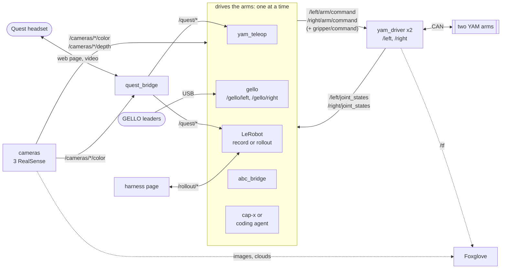

# sparklab-robotics

Software for SparkLab's bimanual robot: two [i2rt YAM-Ultra](https://github.com/i2rt-robotics/i2rt)
arms, three RealSense cameras, a Meta Quest headset and two GELLO leaders. Everything
runs on **ROS 2 Humble**; [LeRobot](https://github.com/huggingface/lerobot) plugins
record datasets and run policies on top.

Why things are built this way: [`DESIGN.md`](DESIGN.md).

## How it fits together



- The two **drivers** are the only thing that talks to the motors. They clamp
  every command to a small step, publish the measured joints, and park the arms
  on Ctrl-C.
- **One thing drives the arms at a time:** Quest teleop, the GELLO leaders, a
  LeRobot recording or rollout, the ABC bridge, cap-x, or the coding agent.
- The **camera node** publishes colour and aligned depth for each camera; anything
  can subscribe.

## Packages

| package | what it is |
|---|---|
| [`sparklab_yam`](src/sparklab_yam/README.md) | the robot: arm driver, Quest teleop, keyboard, IK, arm model, camera calibration, `yam.launch.py` |
| [`sparklab_quest`](src/sparklab_quest/README.md) | the Quest headset: web page and bridge node |
| [`sparklab_cameras`](src/sparklab_cameras/README.md) | the RealSense camera node and setup tools |
| [`sparklab_gello`](src/sparklab_gello/README.md) | GELLO leaders driving the arms joint to joint |
| [`lerobot_robot_sparklab`](src/lerobot_robot_sparklab/README.md) | LeRobot plugin: robot, Quest teleoperator, recording, live rollout, harness |
| [`abc_bridge`](src/abc_bridge/README.md) | runs ABC's released policy on the rig |
| [`capx_sparklab`](src/capx_sparklab/README.md) | cap-x: an LLM drives both arms through perceive / grasp / move tools |
| [`coding_agent_sparklab`](src/coding_agent_sparklab/README.md) | chat with Claude Code or Antigravity while it drives the arms |
| [`sparklab_sim`](src/sparklab_sim/README.md) | Isaac Sim digital twin of the rig |
| [`scripts/`](scripts/README.md) | everyday commands: record, roll out, debug a policy |
| [`archive/`](archive/README.md) | retired code kept for reference |

## Setup

One conda env holds ROS 2 ([RoboStack](https://robostack.github.io)), LeRobot and i2rt:

```bash
mamba create -n sparklab-ros -c conda-forge -c robostack-humble \
    python=3.12 numpy=2.2 ros-humble-ros-base colcon-common-extensions \
    ros-humble-foxglove-bridge ros-humble-rosbag2-storage-mcap
conda activate sparklab-ros
conda env config vars set LD_LIBRARY_PATH="$CONDA_PREFIX/lib" && conda activate sparklab-ros

pip install "lerobot==0.6.0" mujoco pyrealsense2 fastapi "uvicorn[standard]" aiortc av \
    opencv-python-headless pyyaml "setuptools<80" "pytest<8"
git clone https://github.com/i2rt-robotics/i2rt && pip install -e ./i2rt
pip install "lerobot_teleoperator_yamactiveleader @ git+https://github.com/uynitsuj/lerobot_teleoperator_yamactiveleader@4ed519781152562ba338a8ebcd0e4cd781b3029f"   # GELLO only
conda install -c conda-forge ffmpeg
```

Don't skip the `LD_LIBRARY_PATH` line: without it torch and ROS fail to load
together. If i2rt's `ruckig` fails to build, use `pip install --no-deps -e ./i2rt`.

Build once, then source the workspace in every new terminal:

```bash
colcon build --symlink-install
source install/setup.bash
```

## Running

Start the rig first and leave it running:

```bash
ros2 launch sparklab_yam yam.launch.py                  # real arms, cameras, headset bridge
ros2 launch sparklab_yam yam.launch.py teleop:=true     # ...and drive the arms from the Quest
ros2 launch sparklab_yam yam.launch.py sim:=true viewer:=true cameras:=false   # no hardware
```

On start the arms ramp to the rest pose; on Ctrl-C they fold to the park pose
(all zeros) before the motors turn off. Keep the space around them clear.

| to... | run |
|---|---|
| drive the arms from the Quest | `yam.launch.py teleop:=true`, controls in [`sparklab_yam`](src/sparklab_yam/README.md#quest-teleop) |
| drive both arms from the GELLO leaders (starts the drivers too) | `ros2 launch sparklab_gello teleop.launch.py`, then `ros2 service call /gello/arm std_srvs/srv/Trigger` |
| move one joint at a time from the keyboard | `ros2 run sparklab_yam keyboard` |
| record a dataset | `./scripts/record_manual.sh` |
| run a policy | `./scripts/rollout.sh` |
| run ABC's policy | see [`abc_bridge`](src/abc_bridge/README.md) |
| let an LLM drive the arms through tools (cap-x) | see [`capx_sparklab`](src/capx_sparklab/README.md#running-a-session) |
| chat with a coding agent that drives the arms | `ros2 run coding_agent_sparklab ui`, then open http://localhost:8090 |
| calibrate where a camera is | see [`sparklab_yam`](src/sparklab_yam/README.md#calibrating-a-camera) |
| run a policy in Isaac | see [`scripts/`](scripts/README.md#run-a-policy) |

## Topics and services

`<arm>` is `left` or `right`.

| topic | type | |
|---|---|---|
| `/<arm>/joint_states` | `JointState` | measured joints 1–6 + gripper, 100 Hz |
| `/<arm>/ee_pose` | `PoseStamped` | gripper pose in the arm's base frame |
| `/<arm>/arm/command` | `Float64MultiArray` | 6 joint targets (rad) |
| `/<arm>/gripper/command` | `Float64` | gripper target, 0 closed .. 1 open |
| `/cameras/<id>/color/image_raw` | `Image` | colour image, RGB |
| `/cameras/<id>/depth/image_raw` | `Image` | depth in mm, aligned to the colour image |
| `/cameras/<id>/points` | `PointCloud2` | colour point cloud, only while something subscribes |
| `/quest/*` | | headset and controller poses and buttons, see [`sparklab_quest`](src/sparklab_quest/README.md#topics) |
| `/tf`, `/tf_static` | `TFMessage` | where every arm and camera is |

| service | type | |
|---|---|---|
| `/<arm>/park` | `std_srvs/Trigger` | slowly fold the arm to all zeros and hold it there |
| `/<arm>/zero_gravity` | `std_srvs/SetBool` | `true`: the arm floats and you move it by hand; `false`: hold where it is |
| `/rollout/*` | | steer a running policy, see [`rollout/`](src/lerobot_robot_sparklab/lerobot_robot_sparklab/rollout/README.md) |

```bash
ros2 service call /left/park std_srvs/srv/Trigger
ros2 service call /left/zero_gravity std_srvs/srv/SetBool "{data: true}"
```

Node parameters are read at start-up: edit `src/sparklab_yam/config/yam.yaml` and restart.

## Watching it: Foxglove

```bash
ros2 launch foxglove_bridge foxglove_bridge_launch.xml port:=8766
```

In [Foxglove](https://foxglove.dev): *Open connection → Foxglove WebSocket →* `ws://localhost:8766`.
From a laptop, first run `ssh -L 8766:localhost:8766 <rig>`.

For a 3D view, add a *3D* panel with display frame `left_base` and turn on the
`/cameras/<id>/points` topics. The frames:

```
left_base ─┬─ left_tool0 ── left_wrist
           ├─ top
           └─ right_base ── right_tool0 ── right_wrist
```

Record raw topics with `ros2 bag record -s mcap <topics>`; open the `.mcap` in Foxglove.

## Tests

No hardware needed:

```bash
colcon test --packages-select sparklab_quest sparklab_yam sparklab_cameras sparklab_gello capx_sparklab coding_agent_sparklab abc_bridge && colcon test-result --verbose
./scripts/capx_python.sh -m pytest src/capx_sparklab/test     # cap-x's planning, on the GPU
```

## License

Apache-2.0.
