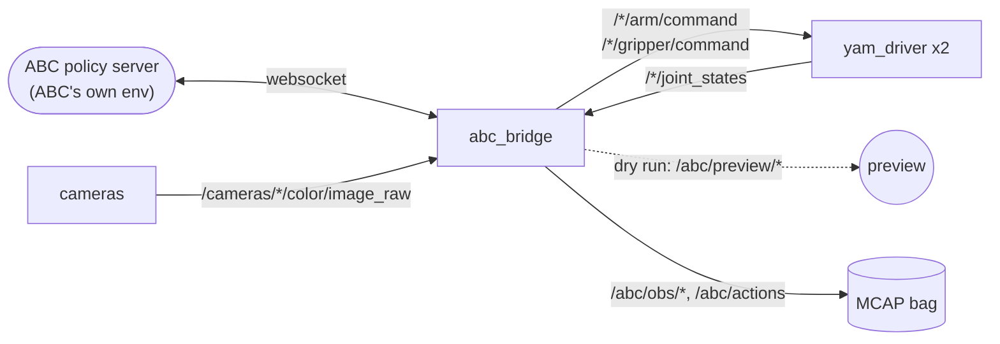

# abc_bridge

Runs [ABC](https://github.com/amazon-far/abc)'s released policy on the rig. ABC runs
unchanged as its own websocket server; this node is its client.



## Running

```bash
# 1. ABC's server, in ABC's clone (~3 min to start)
uv run deploy/serve_policy.py --policy.fast-inference \
  --policy.checkpoint-path=$ABC_CACHE/abc_dit_xl_200k_model.pt --port 8000

# 2. the rig; wait for the drivers to log "at the rest pose"
ros2 launch sparklab_yam yam.launch.py

# 3. the bridge: a dry run first
ros2 run abc_bridge bridge --ros-args -p prompt:="throw plastic bottles in bin"
ros2 run abc_bridge bridge --ros-args -p prompt:="throw plastic bottles in bin" -p dry_run:=false
```

With fast inference, the server's first request recompiles the model for several
minutes. Send it one before starting the bridge.

An episode goes like this:

1. Both arms ramp over 5 s to the start pose.
2. The bridge prints how far the first action moves each joint and waits for **Enter**.
3. It runs the policy at 30 Hz until **Ctrl-C**, then parks both arms (not in a dry run).

It also stops and parks if a camera image or joint state is more than 0.5 s old, if
the policy asks a joint to go more than 0.5 rad from where it is, or if recording fails.

| parameter | default | |
|---|---|---|
| `prompt` | required | must match a task the checkpoint was trained on |
| `dry_run` | `true` | publish to `/abc/preview/*` instead of moving the arms |
| `host`, `port` | `localhost`, `8000` | ABC's server |
| `record_dir` | none | record each episode to `<record_dir>/<time>_<prompt>/` (MCAP) |
| `noise_seed` | `-1` | `>= 0`: send fresh random noise with each request; `-1`: the server uses zeros ([why](../../DESIGN.md#the-abc-bridge)) |
| `start_pose` | ABC's | per-arm start, 6 joints then gripper, e.g. `[0.,0.,0.,0.,0.,0.,1.]` for policies trained on our GELLO demos |

## What ABC sees and sends

| ABC | rig |
|---|---|
| `state` (14,) | left then right `joint_states`: joints 1–6, gripper |
| `images.top`, `.left`, `.right` | the `top`, `left_wrist` and `right_wrist` colour images, cropped to 4:3 and resized to 640x480 |
| `actions[:, 0:7]` | left arm (6 joints) and gripper |
| `actions[:, 7:14]` | right arm and gripper |

Joints are absolute, in rad; the gripper is 0 closed .. 1 open. Each reply holds
30 actions, of which 16 run, using ABC's real-time chunking settings.

With `record_dir`, the bag holds the joint states, the commands, and every request
and reply as sent (`/abc/obs/*`, `/abc/actions`).
