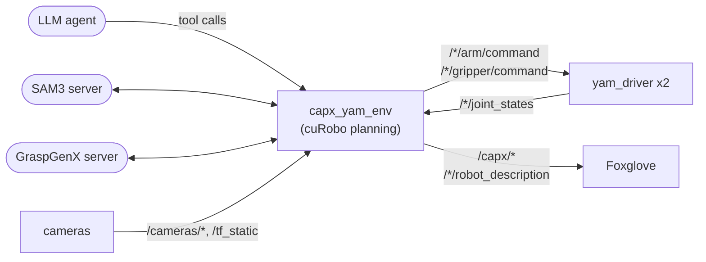

# capx_sparklab

cap-x on the rig: an LLM writes Python against
typed tools (perceive, plan a grasp, move, hand over) that run on both arms.
cap-x itself stays in its own checkout, `../cap-x` next to this repo (set `CAPX=`
for another); this package is the robot side.



Everything here runs under [`scripts/capx_python.sh`](../../scripts/capx_python.sh),
which puts cap-x's GPU stack and this workspace's ROS 2 in one Python.

## Running a session

1. **The rig**, without teleop: `ros2 launch sparklab_yam yam.launch.py`.
2. **The perception servers**, each in its own terminal:

   ```bash
   CAPX=../cap-x G=../cap-x/capx/third_party/GraspGenX
   ./scripts/capx_python.sh $CAPX/capx/serving/launch_sam3_server.py --port 8114
   ./scripts/capx_python.sh $G/client-server/graspgenx_server.py --port 5556 \
       --config $G/ext/graspgenx_checkpoints/GraspGenXModel/release/gen/config.yaml \
       --assets_dir $G/ext/gripper_descriptions/gripper_descriptions/assets
   ```

   SAM3's weights are gated on Hugging Face: request access, then `huggingface-cli login` once.
3. **The model's key.** `gemini:` models read a Vertex AI service-account file from
   `GEMINI_KEY_FILE` (default `~/.config/capx/gemini_key.json`; keep it mode 600, out
   of the repo). OpenAI models read `OPENAI_API_KEY`.
4. **The agent:**

   ```bash
   ./scripts/capx_python.sh -m capx_sparklab.agent --model gemini:gemini-3.8-flash
   ```

   Open http://localhost:8090 for the dashboard (cameras, the agent's steps, and where
   you type instructions) and http://localhost:8081 for the 3D view.

Stop with Ctrl-C. Whenever it exits, both arms park; anything still held is folded in.

`--cameras` picks what the model sees (`top` by default, `left_wrist`, `right_wrist`);
`--silent` turns off its voice.

**In Foxglove:** in a 3D panel (display frame `left_base`) add two *URDF* layers from
the topics `/left/robot_description` and `/right/robot_description`, then turn on
`/capx/perceived`, `/capx/perceived_box` and `/capx/grasps`.

## The gripper

cap-x's model has i2rt's **stock** gripper, not the long fin-ray gripper now on
the rig, so its grasps are planned for the wrong fingers. To change the gripper,
edit the constants in [`robot/__init__.py`](capx_sparklab/robot/__init__.py), then
rebuild and rerun the tests:

```bash
./scripts/capx_python.sh -m capx_sparklab.robot.build
```

## The tools

cap-x's SparkLab tools, with these differences:

| tool | on this rig |
|---|---|
| anything that moves an arm or gripper | needs `arm_id`, `"left"` or `"right"` |
| `get_state(arm_id=None)` | both arms when none is named |
| `close_gripper` | returns `{final_width, effort}`; check the grasp with `view_cameras` |
| `handover(from_arm, to_arm, height=0.30)` | new: pass a held object to the other gripper |
| `lift(arm_id)` | new: back out of the grasp just reached |

Every motion is planned by cuRobo against the camera depth and the table; one that
doesn't plan raises and nothing moves. An arm that falls 0.15 rad behind its
trajectory stops and holds.

## Tests

```bash
./scripts/capx_python.sh -m pytest src/capx_sparklab/test
```
