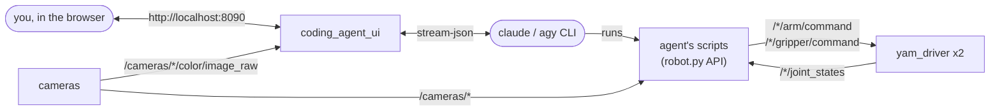

# coding_agent_sparklab

A web page for directing a coding agent on the rig: the three cameras on the left,
a chat on the right. The agent, **Claude Code** or **Antigravity**, drives the arms
by writing and running Python against joint-level functions, the camera frames
and the rig's calibration. There are no perception or grasp tools; for those see
[`capx_sparklab`](../capx_sparklab/README.md).



```
coding_agent_sparklab/robot.py        the agent's API
coding_agent_sparklab/ui.py           the page's server
coding_agent_sparklab/prompt.md       the agent's brief
coding_agent_sparklab/saved_skills/   skills the agent saved
```

## Running

```bash
ros2 launch sparklab_yam yam.launch.py      # the rig, without teleop
ros2 run coding_agent_sparklab ui           # then open http://localhost:8090
ros2 run coding_agent_sparklab ui --port 8091 --workdir ~/robot_scripts
```

The page listens on localhost only. From a laptop, use `ssh -L 8090:localhost:8090 <rig>`.
`--workdir` is where the agent writes and runs its scripts; by default it is a new
folder under `~/.local/share/coding_agent_sparklab/`.

To try it on the [MuJoCo sim](https://github.com/minhphd/sparklab_sim), start
`ros2 run sparklab_sim sim` and run the page with `ROS_DOMAIN_ID=42`.

## The page

- **Agent menu:** Claude Code or Antigravity. Each keeps its own conversation.
- **Chat:** your messages, the agent's replies, and every command it runs. Click a
  command to see its output.
- **Stop:** kills both agents and anything they started, then parks both arms. Your
  next message continues the conversation.

## The agents

| agent | needs |
|---|---|
| Claude Code | `claude` on `PATH`, signed in |
| Antigravity | `agy` on `PATH`, signed in, and the rule below. Not tried yet |

The agent may edit files in `--workdir` and `saved_skills/` and run the env's
Python, and nothing else. Antigravity needs that Python allowed once, in
`~/.gemini/antigravity-cli/settings.json`:

```json
{"permissions": {"allow": ["command(/home/<you>/.conda/envs/sparklab-ros/bin/python)"]}}
```

## Saved skills

The agent saves what works in `saved_skills/<name>/`, the way Claude Code stores
skills: a `SKILL.md` (name, description, usage) and a `scripts/` folder. It sees the
list at every start and reuses them.

| skill | |
|---|---|
| `rig-toolkit` | shared helpers the other skills import |
| `perceive-table` | find every object on the table with the top camera |
| `pick` | `fast_pick.py ARM X Y`: grasp, lift, check it is held |
| `place-down` | `place_down.py ARM TABLE_Z`: set the held object down and release |

## The robot API

```python
from coding_agent_sparklab.robot import (get_joint_angles, get_ee_pose, fk, ik, command, get_image,
                                         get_depth, get_intrinsics, EXTRINSICS, FINGERTIPS)
```

| function | returns |
|---|---|
| `get_joint_angles(arm)` | joints 1–6 (rad) and the gripper (1 open .. 0 closed) |
| `get_ee_pose(arm)` | tool0 position `(3,)` and quaternion wxyz `(4,)` |
| `fk(joint_angles)` | tool0 pose for joints 1–6 |
| `ik(position, quat_wxyz, seed=None)` | joints 1–6, or `ValueError` if unreachable |
| `command(arm, joint_angles)` | moves the arm (and gripper, if a 7th value is given) at ≤ 0.4 rad/s; returns when there |
| `get_image(camera)` | a fresh colour frame, `(H, W, 3)` uint8 RGB |
| `get_depth(camera)` | a fresh depth frame in m, aligned with `get_image` |
| `get_intrinsics(camera)` | `K` and distortion coefficients |
| `EXTRINSICS` | `{(parent, child): 4x4}` from `sparklab_yam/config/extrinsics.yaml` |
| `FINGERTIPS` | 0.075 m: how far past `tool0` the fin-ray fingertips end |

- `arm` is `"left"` or `"right"`; poses are in that arm's base frame (x forward,
  y left, z up). `camera` is `"top"`, `"left_wrist"` or `"right_wrist"`.
- `command` stops and holds the arm if it falls 0.15 rad behind.
- Everything raises if the driver's joint states are older than 0.5 s.
