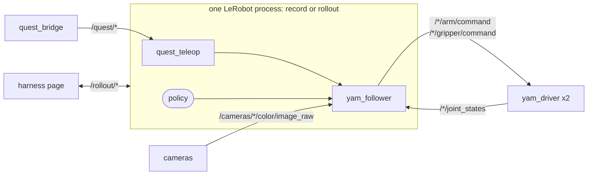

# lerobot_robot_sparklab

The rig in [LeRobot](https://github.com/huggingface/lerobot). Once the workspace is
built and sourced, every `lerobot-*` command understands:

```
--robot.type=yam_ultra_bimanual   the real arms, through the drivers
--robot.type=yam_ultra_sim        the Isaac twin, over HTTP
--teleop.type=bi_quest_teleop     the Quest headset
```



```
lerobot_robot_sparklab/follower.py       the real robot
lerobot_robot_sparklab/teleoperator.py   the Quest
lerobot_robot_sparklab/sim_follower.py   the Isaac twin
lerobot_robot_sparklab/record_manual.py  record a dataset, episodes started and ended by hand
lerobot_robot_sparklab/rollout/          run a policy you can retarget while it runs
lerobot_robot_sparklab/harness/          a web page and AI agent that pick the policy's task
```

Start the rig first: `ros2 launch sparklab_yam yam.launch.py`.

## The robot (`yam_ultra_bimanual`)

- **Observation:** `left_joint_1.pos` … `left_joint_6.pos`, `left_gripper.pos`, the
  same for `right_`, and one RGB image per camera.
- **Action:** the same `.pos` keys, clamped per step like the driver clamps.
- **Safety:** it raises instead of acting on joint states or images older than
  0.5 s, and parks both arms on disconnect.

## Recording (`record_manual`)

Run `./scripts/record_manual.sh` (flags as for `lerobot-record`) and drive the arms
with the Quest:

| key | does |
|---|---|
| Space, or B/Y on a controller | start / end an episode (saved, then the arms park) |
| `r` | throw away the current episode (and park) |
| `q` / Esc | quit; an unfinished episode is thrown away |

It records the action actually sent, and also the raw headset and controller poses
(`observation.xr.*`). `--resume=true` adds to an existing dataset.

## More

- [`rollout/`](lerobot_robot_sparklab/rollout/README.md): retarget a running policy
- [`harness/`](lerobot_robot_sparklab/harness/README.md): the AI agent web page
