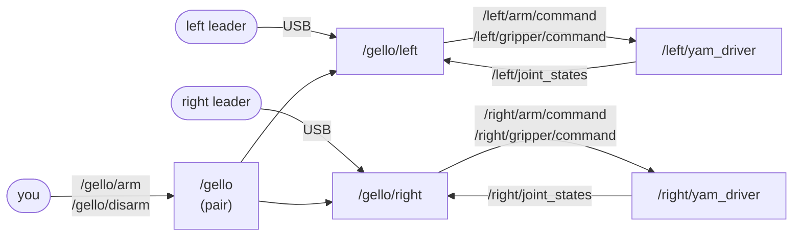

# sparklab_gello

Drive the YAM arms from GELLO leaders (YAM Active Leader), joint to joint.



```
launch/teleop.launch.py    both drivers and both GELLO nodes
sparklab_gello/node.py     one leader driving one arm
sparklab_gello/pair.py     /gello/arm and /gello/disarm for both arms at once
config/                    each leader's EEPROM calibration and GELLO -> YAM mapping
```

Needs `lerobot_teleoperator_yamactiveleader` in the env (see the [setup](../../README.md#setup)).

## Running

Both arms. This starts the drivers too, so don't run `yam.launch.py` alongside it:

```bash
ros2 launch sparklab_gello teleop.launch.py                          # real arms
ros2 launch sparklab_gello teleop.launch.py sim:=true viewer:=true   # simulated arms
ros2 service call /gello/arm std_srvs/srv/Trigger                    # both arms follow
ros2 service call /gello/disarm std_srvs/srv/Trigger                 # both stop
```

One arm, with the rig already running:

```bash
ros2 run sparklab_gello gello --ros-args -p arm:=left
ros2 service call /gello/arm std_srvs/srv/Trigger
```

## What to expect

1. **Start:** once its arm holds still, each leader moves to match it, then goes
   limp. Keep your hands off until `leader homed and released` is logged.
2. **Disarmed:** the leader gently follows its arm. You can push it by hand.
3. **`/gello/arm`:** arms both arms, or neither. It is refused, with the reason,
   if a leader joint is more than 0.15 rad from its arm, if something else is
   commanding the arm, or if `joint_states` is stale.
4. **Armed:** the leader is limp and the arm follows it, speed-limited.
5. **Fault:** a bad reading, an unplugged leader or a silent driver holds the arm
   where it is. Call `/gello/arm` again. After a USB replug, restart the node first.
6. **Ctrl-C:** the leaders fold to zero, then go limp, while the drivers park the
   arms. Keep hands off.

If the node is killed, the arm holds its last target.

## Parameters

| parameter | default | |
|---|---|---|
| `arm` | `left` | `left` or `right` |
| `port` | auto | the leader's serial port; auto when only one is plugged in. The launch picks each leader by USB serial |
| `home` | `true` | match the leader to the arm at start |
| `mirror` | `true` | while disarmed, the leader follows the arm |
| `hold` | `false` | lock the leader's joints once you hold it still for 1 s; push a joint to release |

The safety limits (speed caps, timeouts) are in `GuardLimits` in `guard.py`. They are
simulation defaults, not yet tuned on hardware.

## Leader calibration

Each leader unit has two files in `config/`:

- `yam_active_leader*_eeprom.json`: its servo calibration, read back from the
  EEPROM. This package never writes the EEPROM.
- `gello_to_yam*.yaml`: per joint, the sign and zero that map the leader to the
  YAM, plus the lever's closed and open ends. Both mappings are provisional.

A new leader unit needs its own pair of files.

## Simulation on macOS

```bash
export ROS_LOCALHOST_ONLY=1    # in every terminal
mjpython -m sparklab_yam.driver --ros-args -r __ns:=/left -r __node:=yam_driver -p sim:=true -p viewer:=true
ros2 run sparklab_gello gello --ros-args -p arm:=left
```

The MuJoCo window needs `mjpython` on macOS. Stop the GELLO node before the driver.
