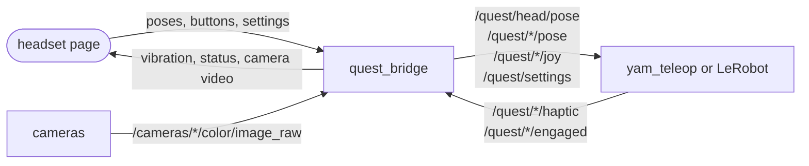

# sparklab_quest

The Meta Quest headset. The headset opens a web page (no app); this package
serves it and turns what it sends into ROS topics.



```
sparklab_quest/bridge.py        the bridge node: serves the page, publishes /quest/*, streams camera video
sparklab_quest/input.py         QuestInput: the latest controller state, for your own node
sparklab_quest/buttons.py       button indices
sparklab_quest/pose_mapping.py  the clutch: controller motion -> gripper target
web/                            the page
```

## Running

`yam.launch.py` starts the bridge. Open `https://<rig>:8443/` in the Quest browser.

The headset only allows VR on a secure page. Make a certificate once with
`./scripts/make_certs.sh` and accept it once in the headset browser. Over a USB
cable (`adb reverse tcp:8443 tcp:8443`), plain `http://localhost:8443` works.

## Topics

| topic | type | |
|---|---|---|
| `/quest/head/pose` | `PoseStamped` | headset pose |
| `/quest/<arm>/pose` | `PoseStamped` | controller pose, at your wrist |
| `/quest/<arm>/joy` | `Joy` | buttons (pressed) and axes (0..1), indexed as below |
| `/quest/settings` | `String` | JSON of the page's sliders |
| `/quest/<arm>/haptic` | `Float32` | vibration strength 0..1, from teleop |
| `/quest/<arm>/engaged` | `Bool` | clutch held, from teleop |

The frame is `quest`: Y up, −Z the way you faced when entering VR, origin on the
floor. Quaternions are `[x, y, z, w]`.

| button | index | teleop uses it for |
|---|---|---|
| `TRIGGER` | 0 | gripper |
| `GRIP` | 1 | clutch |
| `THUMBSTICK` | 3 | send the arm home |
| `A_X` | 4 | precision mode |
| `B_Y` | 5 | arm / disarm; start / end a recording episode |

## Reading the Quest from your own node

```python
from sparklab_quest import buttons
from sparklab_quest.input import QuestInput

quest = QuestInput(node)               # subscribes on your node
ctrl = quest.controller("right")       # None until the first pose arrives
if ctrl and ctrl.age_s < buttons.XR_FRAME_STALE_TIMEOUT_S:
    holding = buttons.pressed(ctrl.buttons, buttons.GRIP)
    squeeze = buttons.value(ctrl.axes, buttons.TRIGGER)
```
