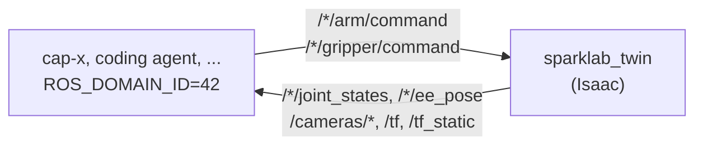

# sparklab_sim

Isaac Sim copies of the rig, on Isaac's own Python (Isaac Sim 5.1, `behavior`
conda env). Not a ROS package: run everything through `./scripts/isaac_python.sh`.

- **The digital twin** (`twin.py`): the calibrated rig with physics, serving the
  real rig's topics on ROS domain 42. Anything that drives the rig, cap-x for one,
  drives the twin unchanged.
- **The policy server** (`policy_server.py`): an HTTP server for LeRobot's
  `yam_ultra_sim` robot.



## The digital twin

```bash
./scripts/isaac_python.sh -m sparklab_sim.convert --twin    # once, and after capx_sparklab.robot.build
./scripts/isaac_python.sh -m sparklab_sim.twin              # serves on ROS domain 42
ROS_DOMAIN_ID=42 ./scripts/capx_python.sh -m capx_sparklab.agent
```

Don't activate a conda env first. `--domain N` picks another domain; `--gui` opens
Isaac's window. Startup takes under a minute.

It serves the drivers', cameras' and TF topics with the same names, frames and
units as the rig, plus `/<arm>/park`. Differences: `zero_gravity` is refused,
cameras run at 8 Hz, and `/tf` also carries each prop's true pose (`twin/<prop>`)
for scoring. Nothing that drives the robot may read those.

The twin models i2rt's stock gripper. Its props (a marker, a soda can, a bowl, an
apple, a mug, and a box) are BEHAVIOR-1K objects listed in
`twin_scene.DEFAULT_PROPS`, read from `~/BEHAVIOR-1K` (`BEHAVIOR_1K=` to change).

## The policy server

```bash
./scripts/isaac_python.sh -m sparklab_sim.convert                         # once
./scripts/isaac_python.sh -m sparklab_sim.policy_server --port 8081 --physics
./scripts/rollout.sh --robot=sim                                          # elsewhere
```

Use `--physics` whenever objects are touched, or the gripper can't hold anything.
Leave the server running between rollouts; it parks the arms after 45 s idle. It
was written against Isaac 6.0 and has not been rerun on 5.1.

To edit its scene, run `./scripts/isaac_python.sh -m sparklab_sim.live`, open
http://127.0.0.1:8080/, and edit `sparklab_yam/sparklab_yam/sim/scene.usda`; the
view updates on save.

## Notebooks

Run `./scripts/install_isaac_kernel.sh` once, then in VS Code pick **Select Kernel →
Jupyter Kernel → SparkLab Isaac Sim**. Create `SimulationApp` before importing
anything from `omni.*` or `isaacsim.*`, and `print(..., flush=True)`.
