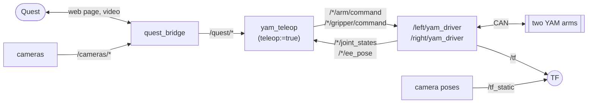

# sparklab_yam

The YAM-Ultra robot: the arm driver, Quest teleop, keyboard control, IK, the arm
model, camera calibration, and `yam.launch.py`, which starts the whole rig.

What `yam.launch.py` starts:



```
launch/yam.launch.py        both drivers, the cameras, the headset bridge, the camera poses, optionally teleop
config/                     this rig's settings: see config/README.md
sparklab_yam/driver.py      the arm driver (one per arm)
sparklab_yam/teleop_node.py Quest teleop
sparklab_yam/keyboard.py    keyboard control, one joint at a time
sparklab_yam/calibration.py camera-to-arm calibration
sparklab_yam/ik/            inverse kinematics
sparklab_yam/model/         the arm model
```

## Starting the rig

```bash
ros2 launch sparklab_yam yam.launch.py                    # real arms
ros2 launch sparklab_yam yam.launch.py teleop:=true       # + Quest teleop
ros2 launch sparklab_yam yam.launch.py sim:=true viewer:=true cameras:=false
```

| argument | default | |
|---|---|---|
| `sim` | `false` | simulated arms instead of CAN |
| `viewer` | `false` | a MuJoCo window per simulated arm |
| `cameras` | `true` | start the camera node |
| `teleop` | `false` | start Quest teleop |
| `certfile`, `keyfile` | `./cert.pem`, `./key.pem` | HTTPS certificate for the headset page |

## The driver

One per arm, in the `/left` or `/right` namespace.

| name | | |
|---|---|---|
| `joint_states` | out | joints 1–6 + gripper, 100 Hz |
| `ee_pose` | out | gripper pose (`tool0`) in the arm's base frame; also on `/tf` |
| `arm/command` | in | 6 joint targets, rad |
| `gripper/command` | in | 0 closed .. 1 open |
| `park` | service | fold the arm to all zeros and hold it |
| `zero_gravity` | service (`SetBool`) | `true`: the arm floats, commands are ignored; `false`: hold where it is |

- **Every command is clamped:** no joint moves more than `max_step` (0.133 rad
  for joints 1–3, 0.15 for 4–6) from where it is.
- **On start** the gripper homes itself, then the arm ramps to the rest pose
  `[0, 0.5, 1.0, -1.0, 0, 0]` (`rest_on_start`), ignoring commands until it is
  there. The upper arm swings up to 28 cm behind the base on the way: keep it clear.
- **On Ctrl-C** it parks, then cuts torque.
- **If the motors stop responding**, `joint_states` stops.

Settings are in `config/yam.yaml`. To tune one arm only, put the line under
`/left/yam_driver` or `/right/yam_driver`. `kp`, `kd` and `velocity_feedforward`
set how tightly the arm tracks its commands; GELLO teleop raises them
([why](../../DESIGN.md#wrist-gains-and-velocity-feed-forward-in-teleoplaunchpy)).

**Gravity compensation.** If the arm sinks in zero gravity, raise
`zero_gravity_comp_factor`; if it drifts up, lower it, in steps of about 0.05,
mostly on joints 2, 3 and 5. `gravity_comp_factor` does the same while holding
position. After changing the gripper, set `ee_mass` first (0.953 for the long
fin-ray gripper; 0 for i2rt's stock one).

## Quest teleop

| control | does |
|---|---|
| **B/Y** | arm / disarm. Starts disarmed; disarming sends the arms home |
| **Grip** (hold) | clutch: the arm follows your hand only while held |
| **Trigger** | close the gripper |
| **A/X** (hold) | precision mode: slower, finer motion |
| **Thumbstick click** | send that arm home |

Home is the rest pose. Speeds and scales are in `config/yam.yaml`; the headset
page's sliders change the scales live. Don't run it while recording or running
a policy; those bring their own teleoperator.

## Keyboard

```bash
ros2 run sparklab_yam keyboard                     # 0.02 rad per press
ros2 run sparklab_yam keyboard --ros-args -p step:=0.05 -p arm:=right
```

| keys | do |
|---|---|
| `q w e r t y` | joint 1–6 **+** |
| `a s d f g h` | joint 1–6 **−** |
| `z` / `x` | open / close the gripper |
| space | switch arm |
| Ctrl-C | quit; the arm holds where it is |

## Calibrating a camera

Finds where a camera sits relative to an arm, with the lab's ChArUco board
(24 × 17 squares of 15 mm, already set in `config/yam.yaml`). Redo it whenever a
camera moves.

1. Start the rig without teleop.
2. Start the calibration for one camera:

   ```bash
   P="--ros-args --params-file src/sparklab_yam/config/yam.yaml"
   ros2 run sparklab_yam calibrate $P -p mode:=eye_in_hand -p arm:=left  -p camera:=left_wrist
   ros2 run sparklab_yam calibrate $P -p mode:=eye_in_hand -p arm:=right -p camera:=right_wrist
   ros2 run sparklab_yam calibrate $P -p mode:=eye_to_hand -p arm:=left  -p camera:=top -p output:=calibration_top_left.yaml
   ros2 run sparklab_yam calibrate $P -p mode:=eye_to_hand -p arm:=right -p camera:=top -p output:=calibration_top_right.yaml
   ```

   For a wrist camera the board lies still on the table, about 20 cm away. For
   the top camera it is clamped to the gripper, within about 50 cm.
3. The arm floats: guide it by hand, and support it the first time. Watch the
   detection on `/calibration/image` in Foxglove.
4. Capture 10–20 poses. Move, hold still, press **Enter**. Tilt and turn the
   gripper a lot, not just slide it. `u` drops the last capture; `s` saves;
   `q` quits.
5. Aim for an **error** under about 1 px and a few mm. A warning means you need
   more rotation.
6. Copy `translation_m` and `quaternion_xyzw` from the saved
   `calibration_<camera>.yaml` into [`config/extrinsics.yaml`](config/extrinsics.yaml)
   and restart the launch.

Save with `s` before quitting: `q` and Ctrl-C discard the captures. If
`calibrate` is killed, the arm keeps floating until
`ros2 service call /left/zero_gravity std_srvs/srv/SetBool "{data: false}"`.

## More

- [`ik/`](sparklab_yam/ik/README.md): the inverse kinematics
- [`model/`](sparklab_yam/model/README.md): the arm model
- [`config/`](config/README.md): cameras and rig settings
